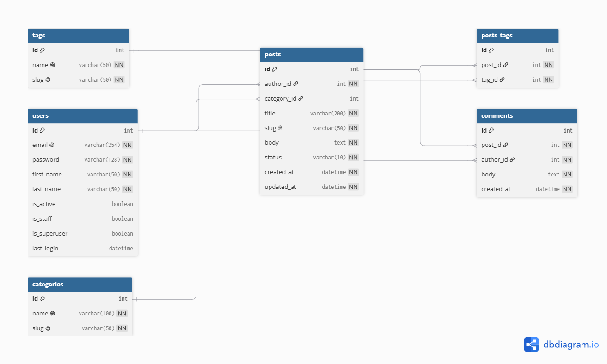
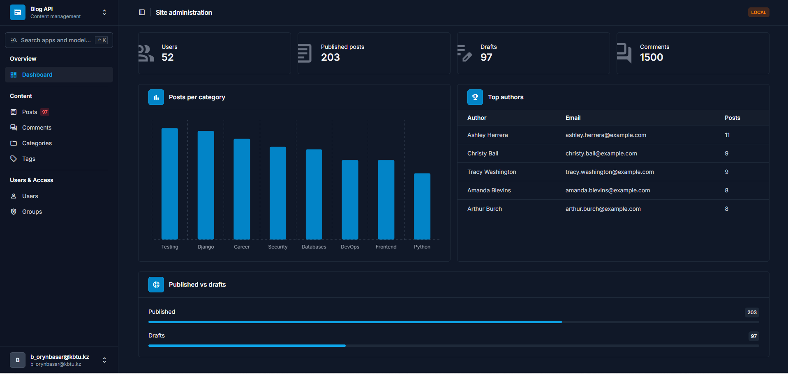
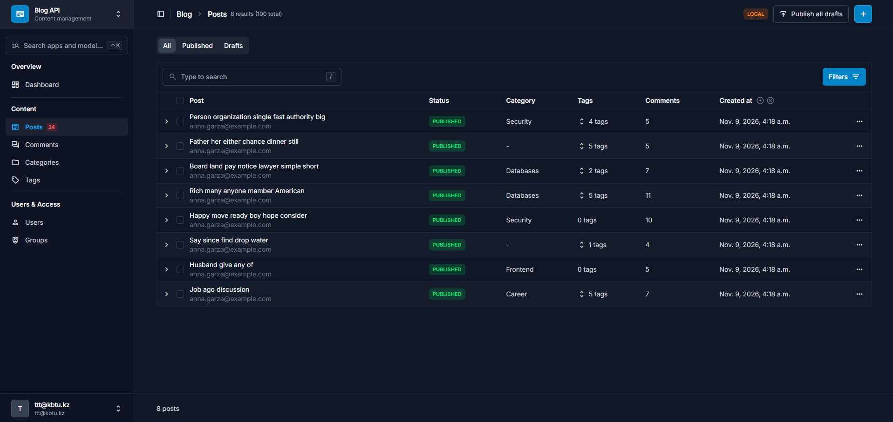
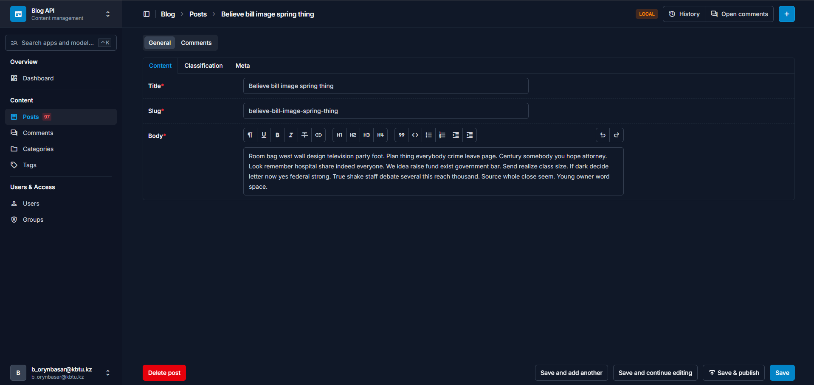
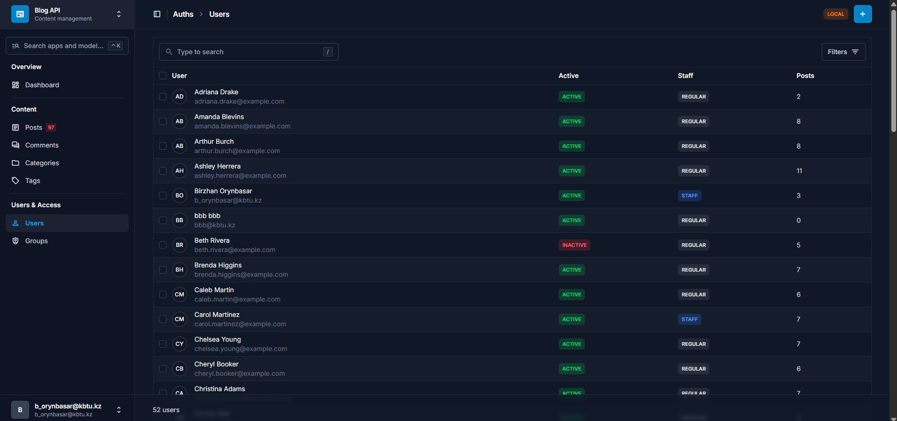

# Blog API

REST API for a blog built with Django and Django REST Framework.

## Stack

- Python 3.11+
- Django 5.2, Django REST Framework
- JWT authentication (`djangorestframework-simplejwt`)
- Django Unfold — admin theme
- Faker — fake data for the `seed` command
- python-decouple for configuration
- SQLite (local), PostgreSQL (prod)

## Project structure

- `apps/auths` — custom user model (email login), JWT authentication
- `apps/blog` — categories, tags, posts, comments, `seed` command, admin callbacks
- `settings/` — project package and configuration (`conf.py`, `base.py`, `env/local.py`, `env/prod.py`)
- `requirements/` — split dependencies (`base`, `dev`, `prod`)
- `templates/admin/` — dashboard template override
- `docs/` — ERD and admin screenshots

## ERD



## Setup

```bash
git clone https://github.com/birzhaaan/blog-api.git
cd blog-api
python -m venv venv
venv\Scripts\activate
pip install -r requirements/dev.txt
```

Create `settings/.env`:

```
BLOG_ENV_ID=local
BLOG_SECRET_KEY=x+x(z4xx6060tkh*9x2ep&p31ftxr)r54xyy6vt+h5m34r*2a6
```

## Run

On an empty database this gives a working admin full of data:

```bash
python manage.py migrate
python manage.py seed
python manage.py createsuperuser
python manage.py runserver
```

Admin panel: http://127.0.0.1:8000/admin/

## Authentication

| Endpoint | Body | Response |
|---|---|---|
| `POST /api/auth/token/` | `{"email": "...", "password": "..."}` | `{"access": "...", "refresh": "..."}` |
| `POST /api/auth/token/refresh/` | `{"refresh": "..."}` | `{"access": "..."}` |

Send the token as `Authorization: Bearer <access>`.

## Seeding

Fills **all** models with fake data: users, categories, tags, posts, comments.

```bash
python manage.py seed
```

| Argument | Default | Description |
|---|---|---|
| `--users` | `20` | Number of users to create |
| `--posts` | `100` | Number of posts to create |
| `--comments` | `500` | Number of comments to create |
| `--clear` | off | Delete existing data before seeding |

Example:

```
$ python manage.py seed --users 50 --posts 300 --comments 1500
Users:       50 created
Categories:   8 created
Tags:        20 created
Posts:      300 created
Comments:  1500 created
Done in 0.73 seconds
```

Notes:

- All seeded users share the password from the `SEED_PASSWORD` constant (`seed-password-123`).
- Objects are inserted with `bulk_create`, so the number of queries does not grow with the number of rows.
- `--clear` removes comments, posts, tags, categories and every user **except superusers**.
- Running the command twice in a row is safe: existing emails and slugs are skipped or suffixed.
- About 70% of posts are `published`, 10% have no category, each post gets 0–5 tags, and comments are only attached to published posts.

## Admin

Built with [Django Unfold](https://unfoldadmin.com/docs/): custom sidebar with a drafts badge,
tabs above the post list, filters with a submit button, autocomplete, row and bulk actions,
WYSIWYG editor and a dashboard.

### Dashboard



### Post list with filters open



### Post edit page



### User list



## Lint

```bash
ruff check .
```